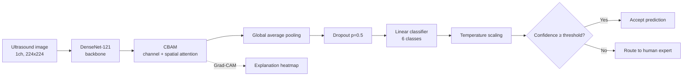

<div align="center">

# 🩺 Uncertainty-Aware & Explainable Fetal Ultrasound Plane Classification

**DenseNet-121 + CBAM attention, with temperature-scaled calibration, selective prediction, and Grad-CAM explanations, served through a Streamlit app that exports PDF reports.**


</div>

---

## Overview

Identifying which anatomical plane a fetal ultrasound image shows (brain, abdomen, femur, thorax, maternal cervix, or other) is the first step in many prenatal screening workflows. Accuracy alone is not enough for a clinical-facing tool: a model also needs to **know when it might be wrong** and **show why it made a prediction**.

This project builds a 6-class plane classifier and wraps it in three trust-oriented components:

| Component | What it does |
|---|---|
| **CBAM attention** | Channel + spatial attention on top of a pretrained CNN backbone to focus on diagnostically relevant regions |
| **Temperature scaling** | Post-hoc calibration so predicted confidence better reflects real-world correctness |
| **Selective prediction** | Predictions below a confidence threshold are routed to a human expert instead of being auto-accepted |
| **Grad-CAM** | Heatmaps showing which image regions drove each prediction |

Three backbones (DenseNet-121, EfficientNet-B0, ResNet-50) were trained and compared under the same protocol. DenseNet-121 was carried forward into the calibration, selective-prediction, and web-app stages.

## Demo App

The Streamlit app (`UI.py`) lets a user upload an ultrasound image and instantly get:

- the predicted plane and calibrated confidence
- a Grad-CAM overlay
- an **ACCEPTED / REVIEW** recommendation based on an adjustable confidence threshold (default 85%)
- a downloadable **PDF report** containing the image, heatmap, and prediction

### Screenshots

Each screenshot shows the uploaded ultrasound (left), the Grad-CAM heatmap (middle), and the prediction panel (right). In all three examples the heatmap concentrates on the anatomical structure that defines the plane.

<div align="center">

**Fetal abdomen** (confidence 93.05%, accepted)
<br/>


**Fetal brain** (confidence 99.42%, accepted)
<br/>


**Fetal thorax** (confidence 96.21%, accepted)
<br/>


</div>

## Method



**Architecture details**

- **Backbone:** ImageNet-pretrained DenseNet-121 with the first convolution replaced by a 1-channel layer for grayscale ultrasound input.
- **Attention:** CBAM block (channel attention with reduction ratio 16, then spatial attention with a 7×7 kernel) applied to the 1024-channel feature map.
- **Head:** global average pooling, dropout (p = 0.5), and a linear layer to 6 classes.
- **Calibration:** a single learned temperature `T` divides the logits; `T` is fitted on the validation set by minimizing NLL with L-BFGS.
- **Selective prediction:** a sample is accepted when its calibrated max-softmax probability is at least the threshold; otherwise it is flagged for review.
- **Explainability:** Grad-CAM computed at the CBAM output layer.

**Training setup**

| Setting | Value |
|---|---|
| Input | 224 × 224, grayscale, normalized to mean 0.5 / std 0.5 |
| Split | 70 / 15 / 15 (train / val / test), fixed seed 42 |
| Loss / optimizer | Cross-entropy, Adam, learning rate 1e-4 |
| Batch size | 32 |
| Schedule | Up to 30 epochs; early stopping (patience 5) with a "stop, evaluate, resume" routine that allows 2 strikes before halting |

## Dataset

Experiments use the **FETAL_PLANES_DB** collection of maternal-fetal ultrasound images (originally released on Zenodo; a Kaggle mirror is available [here](https://www.kaggle.com/datasets/me24b2055vinaysharma/fetal-ultrasound-data-with-6-different-classes)).

| Split | Images |
|---|---|
| Train | 8,680 |
| Validation | 1,860 |
| Test | 1,860 |

**Classes (6):** Fetal abdomen · Fetal brain · Fetal femur · Fetal thorax · Maternal cervix · Other

<div align="center">
  
  <br/>
  <sub>Class distribution across the full dataset.</sub>
</div>

The dataset is **imbalanced**: "Other" is the largest class (roughly 4,200 images) and fetal abdomen the smallest (roughly 700), about a 6:1 ratio. This matters when reading the macro-averaged metrics below, and it is one reason most residual errors involve the "Other" class.

> The dataset is not included in this repository. Download it and point `ROOT_DIR` in the scripts to its location (see [Configuration](#configuration)).

## Results

All numbers are on the held-out **test set (1,860 images)**, with macro-averaged precision, recall, and F1.

### Backbone comparison

| Backbone | Script | Accuracy | Precision | Recall | F1 |
|---|---|---|---|---|---|
| **DenseNet-121** | `DenseNet-121.py` | **95.22%** | 0.9379 | 0.9537 | 0.9454 |
| DenseNet-121 | `Method_using DenseNet-121.py` | 94.62% | 0.9341 | 0.9449 | 0.9390 |
| EfficientNet-B0 | `EfficientNetB0.py` | 94.52% | 0.9316 | 0.9476 | 0.9393 |
| EfficientNet-B0 | `Mehod using EfficientNet-50.py` | 93.82% | 0.9191 | 0.9396 | 0.9286 |
| ResNet-50 | `ResNet50_Updated.py` | 94.35% | 0.9224 | 0.9559 | 0.9374 |

> Two scripts per backbone are independent training runs of the same architecture family, so the gap between them gives a rough sense of run-to-run variation (about half a percentage point).

### Calibration and selective prediction (DenseNet-121 + CBAM)

After temperature scaling (fitted `T` = 1.2708 on the validation set), a 0.85 confidence threshold gives:

| | Coverage | Accuracy | Precision | Recall | F1 |
|---|---|---|---|---|---|
| All test samples | 100% (1,860) | 94.41% | 0.9396 | 0.9254 | 0.9314 |
| **Accepted only** | **86.3% (1,606)** | **97.95%** | 0.9747 | 0.9646 | 0.9692 |
| Routed to expert | 13.7% (254) | n/a | n/a | n/a | n/a |

Rejecting the least-confident ~14% of cases raises accuracy on the remainder from 94.4% to **98.0%**, which is the trade-off the app exposes through its threshold slider.

### Error analysis

<div align="center">
  
</div>

The dominant error mode is confusion with the heterogeneous **"Other"** class: 24 abdomen, 14 femur, and 11 thorax images were predicted as "Other", and 47 "Other" images were assigned to a specific plane. Fetal brain and maternal cervix are classified almost perfectly.

Additional training logs and screenshots for every backbone are in [`Results/`](Results/).

## Repository Structure

```
.
├── UI.py                              # Streamlit app (inference + Grad-CAM + PDF report)
├── DenseNet-121.py                    # Train / evaluate DenseNet-121 + CBAM
├── Method_using DenseNet-121.py       # Second DenseNet-121 training run
├── Method_Con_DenseNet121.py          # Post-training: calibration, selective prediction,
│                                      #   confusion matrix, Grad-CAM
├── EfficientNetB0.py                  # EfficientNet-B0 + CBAM training
├── Mehod using EfficientNet-50.py     # Second EfficientNet-B0 training run
├── ResNet50_Updated.py                # ResNet-50 + CBAM training
├── assets/                            # README images (class distribution, app screenshots)
└── Results/                           # Logs, confusion matrix, calibration, Grad-CAM
    ├── DenseNet-121/
    ├── EfficientNet_B0/
    └── Resnet 50/
```

## Getting Started

### 1. Install dependencies

```bash
git clone https://github.com/<your-username>/<your-repo>.git
cd <your-repo>

python -m venv .venv
source .venv/bin/activate        # Windows: .venv\Scripts\activate

pip install torch torchvision scikit-learn pandas numpy pillow \
            opencv-python matplotlib seaborn streamlit fpdf==1.7.2
```

> `fpdf==1.7.2` (the legacy `fpdf` package) is required: the PDF export code relies on its `output(dest='S')` behavior and will not work with `fpdf2`.

A CUDA-capable GPU is recommended for training; inference runs fine on CPU.

### 2. Configuration

Each training script reads the dataset from a path set at the top of the file. Edit it to match your machine:

```python
ROOT_DIR = r"path/to/FETAL_PLANES_ZENODO"
CSV_PATH = os.path.join(ROOT_DIR, "FETAL_PLANES_DB_data.csv")
IMG_DIR  = os.path.join(ROOT_DIR, "Images")
```

The loader expects the columns `Image_name` and `Plane`.

### 3. Train

```bash
python DenseNet-121.py
```

The best checkpoint (lowest validation loss) is saved as `best_densenet121.pth`.

### 4. Calibrate and evaluate

`Method_Con_DenseNet121.py` loads `best_densenet_fetal.pth`, so copy or rename your checkpoint first:

```bash
cp best_densenet121.pth best_densenet_fetal.pth
python Method_Con_DenseNet121.py
```

This fits the temperature, reports overall and selective-prediction metrics, and shows the confusion matrix and a sample Grad-CAM.

### 5. Launch the app

Place `best_densenet_fetal.pth` next to `UI.py`, then:

```bash
streamlit run UI.py
```

The temperature used by the app is set in `ModelWithTemperature` inside `UI.py`. After calibrating, update it to the value printed by the calibration script.

## Limitations

- **Research prototype, not a medical device.** It has not been clinically validated and must not be used for diagnosis or patient care.
- **Image-level split.** Train/validation/test sets are drawn by random image-level split. If images from the same patient appear in multiple splits, test metrics may be optimistic; a patient-level split is the recommended next step.
- **"Other" class.** Most residual errors involve this catch-all category, which is visually heterogeneous.
- **Single dataset.** Generalization across ultrasound machines, operators, and hospitals has not been evaluated.
- **Single-split results.** Reported numbers come from one fixed split and single training runs, without confidence intervals.

## Roadmap

- [ ] Patient-level splitting to rule out leakage
- [ ] Class-imbalance handling (weighted loss / focal loss / balanced sampling)
- [ ] Data augmentation
- [ ] Calibration metrics (ECE, Brier score) and risk-coverage curves
- [ ] Monte Carlo Dropout inference for predictive uncertainty
- [ ] Cross-device and cross-operator robustness evaluation
- [ ] Ablation study (with / without CBAM)

## Acknowledgments

- Dataset: Burgos-Artizzu, X. P. et al., *Evaluation of deep convolutional neural networks for automatic classification of common maternal fetal ultrasound planes*, Scientific Reports 10, 10200 (2020).
- CBAM: Woo, S. et al., *CBAM: Convolutional Block Attention Module*, ECCV 2018.
- Grad-CAM: Selvaraju, R. R. et al., *Grad-CAM: Visual Explanations from Deep Networks via Gradient-Based Localization*, ICCV 2017.
- Temperature scaling: Guo, C. et al., *On Calibration of Modern Neural Networks*, ICML 2017.

## Author

**Sajid**
CSE, United International University (UIU), Dhaka, Bangladesh
GitHub: [@your-username](https://github.com/your-username) · LinkedIn: [your-profile](https://linkedin.com/in/your-profile)

## License

Released under the [MIT License](LICENSE). *(Add a `LICENSE` file, or change this line to the license you prefer.)*
