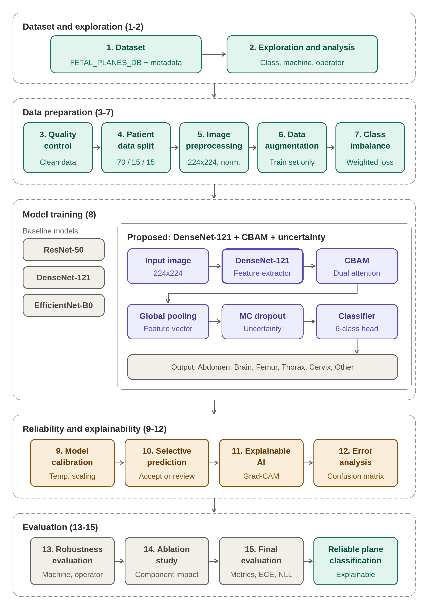
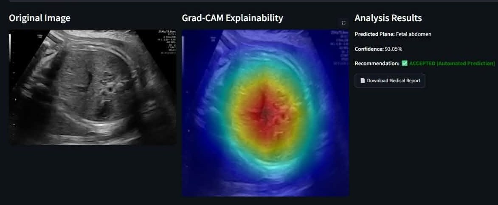
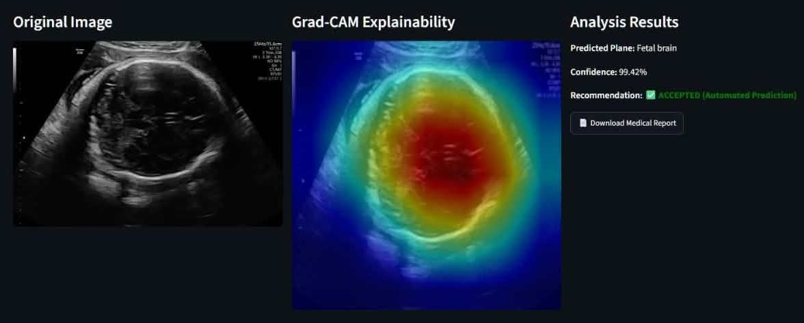
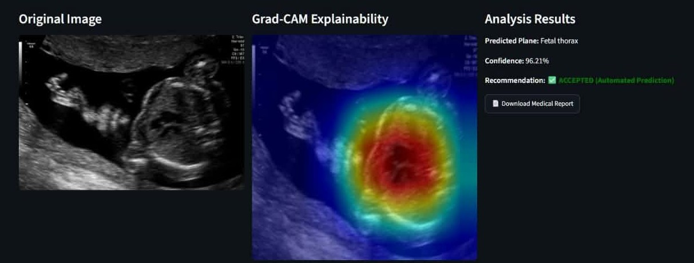
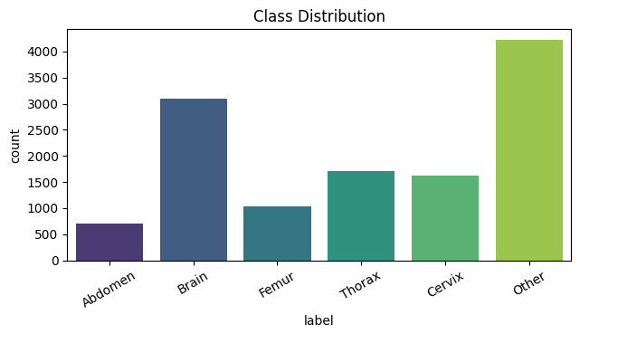

<div align="center">

# 🩺 Uncertainty-Aware & Explainable Fetal Ultrasound Plane Classification

**A DenseNet-121 + CBAM pipeline that doesn't just classify, but calibrates its confidence, defers uncertain cases to a human expert, and explains its predictions.**


</div>

---

## Overview

Recognizing which anatomical plane a fetal ultrasound image shows (abdomen, brain, femur, thorax, maternal cervix, or other) is a basic step in prenatal screening workflows. For a tool that may sit near clinical decisions, accuracy alone is not enough. It must also **signal when it is unsure** and **show why it predicted what it did**.

This project follows a 15-step methodology that goes from data exploration to reliability analysis:

- **Proposed model:** ImageNet-pretrained **DenseNet-121** with a **CBAM** (channel + spatial attention) block and a dropout-based uncertainty head for 6-class classification.
- **Reliability:** post-hoc **temperature scaling** for calibration and **selective prediction** that routes low-confidence cases to a human expert.
- **Explainability:** **Grad-CAM** heatmaps and confusion-matrix error analysis.
- **Deployment demo:** a **Streamlit** app that returns the prediction, heatmap, and a downloadable PDF report.

## Methodology

<div align="center">
  
</div>

The pipeline has five stages:

| Stage | Steps | Goal |
|---|---|---|
| **Dataset and exploration** | 1-2 | Load FETAL_PLANES_DB with metadata; analyze class, machine, and operator distributions |
| **Data preparation** | 3-7 | Quality control, patient-level split (70/15/15), preprocessing, augmentation, class-imbalance handling |
| **Model training** | 8 | Train ResNet-50, DenseNet-121, and EfficientNet-B0; proposed model is DenseNet-121 + CBAM + uncertainty |
| **Reliability and explainability** | 9-12 | Temperature scaling, selective prediction, Grad-CAM, error analysis |
| **Evaluation** | 13-15 | Robustness (machine, operator), ablation study, final evaluation (metrics, ECE, NLL) |

### Implementation status

This repository contains the code and results for the steps marked ✅. Steps marked ⬜ are part of the methodology but are not yet in the code here.

| # | Step | Status | Details / where |
|---|---|---|---|
| 1 | Dataset | ✅ | FETAL_PLANES_DB, 12,400 images, 6 classes |
| 2 | Exploration and analysis | 🟡 | Class distribution done (see [Dataset](#dataset)); machine and operator analysis not included |
| 3 | Quality control | ⬜ | Not in this repo |
| 4 | Data split (70/15/15) | 🟡 | Implemented as a seeded **image-level** random split; patient-level split is pending |
| 5 | Image preprocessing | ✅ | Grayscale, 224 × 224, normalized (mean 0.5, std 0.5) |
| 6 | Data augmentation | ⬜ | Not in this repo |
| 7 | Class imbalance handling | ⬜ | Training currently uses unweighted cross-entropy |
| 8 | Model training | ✅ | ResNet-50, DenseNet-121, EfficientNet-B0, each with CBAM + dropout head |
| 9 | Model calibration | ✅ | Temperature scaling (L-BFGS on validation NLL) in `Method_Con_DenseNet121.py` |
| 10 | Selective prediction | ✅ | Confidence threshold, accept or route to expert (also in the app) |
| 11 | Explainable AI | ✅ | Grad-CAM at the CBAM output layer |
| 12 | Error analysis | ✅ | Confusion matrix |
| 13 | Robustness evaluation | ⬜ | Not in this repo |
| 14 | Ablation study | ⬜ | Not in this repo |
| 15 | Final evaluation | 🟡 | Accuracy, precision, recall, F1 reported; ECE and NLL not yet computed |

✅ done · 🟡 partly done · ⬜ not yet in this repo

## Demo App

The Streamlit app (`UI.py`) accepts an ultrasound image and returns:

- the predicted plane and calibrated confidence
- a Grad-CAM overlay
- an **ACCEPTED / REVIEW** recommendation from an adjustable confidence threshold (default 85%)
- a downloadable **PDF report** with the image, heatmap, and prediction

Each screenshot shows the uploaded image (left), Grad-CAM heatmap (middle), and prediction panel (right). In all three, the heatmap concentrates on the anatomy that defines the plane.

<div align="center">

**Fetal abdomen** (confidence 93.05%, accepted)
<br/>


**Fetal brain** (confidence 99.42%, accepted)
<br/>


**Fetal thorax** (confidence 96.21%, accepted)
<br/>


</div>

## Dataset

Experiments use the **FETAL_PLANES_DB** collection of maternal-fetal ultrasound images (originally released on Zenodo; a Kaggle mirror is available [here](https://www.kaggle.com/datasets/me24b2055vinaysharma/fetal-ultrasound-data-with-6-different-classes)).

**Classes (6):** Fetal abdomen · Fetal brain · Fetal femur · Fetal thorax · Maternal cervix · Other

| Split | Images |
|---|---|
| Train | 8,680 |
| Validation | 1,860 |
| Test | 1,860 |

<div align="center">
  
  <br/>
  <sub>Class distribution across the full dataset.</sub>
</div>

The dataset is **imbalanced**: "Other" is the largest class (roughly 4,200 images) and fetal abdomen the smallest (roughly 700), about a 6:1 ratio. This matters when reading the macro-averaged metrics below.

> The dataset is not included in this repository. Download it and set `ROOT_DIR` in the scripts (see [Configuration](#2-configuration)).

## Model

**Proposed: DenseNet-121 + CBAM + uncertainty head**

| Component | Detail |
|---|---|
| Input | 224 × 224 grayscale (first convolution replaced with a 1-channel layer) |
| Backbone | ImageNet-pretrained DenseNet-121 feature extractor (1024 channels) |
| Attention | CBAM: channel attention (reduction ratio 16), then spatial attention (7 × 7 kernel) |
| Head | Global average pooling → dropout (p = 0.5) → linear layer (6 classes) |
| Calibration | Single learned temperature `T` dividing the logits, fitted on the validation set |
| Selective prediction | Accept if calibrated max-softmax probability ≥ threshold; otherwise send for expert review |
| Explainability | Grad-CAM computed at the CBAM output layer |

**Training setup:** cross-entropy loss, Adam (learning rate 1e-4), batch size 32, up to 30 epochs, early stopping (patience 5) with a "stop, evaluate, resume" routine that allows 2 strikes before halting, fixed seed 42 for the split.

## Results

All numbers are on the held-out **test set (1,860 images)**, with macro-averaged precision, recall, and F1.

### Model comparison (Step 8)

| Backbone | Script | Accuracy | Precision | Recall | F1 |
|---|---|---|---|---|---|
| **DenseNet-121** | `DenseNet-121.py` | **95.22%** | 0.9379 | 0.9537 | 0.9454 |
| DenseNet-121 | `Method_using DenseNet-121.py` | 94.62% | 0.9341 | 0.9449 | 0.9390 |
| EfficientNet-B0 | `EfficientNetB0.py` | 94.52% | 0.9316 | 0.9476 | 0.9393 |
| EfficientNet-B0 | `Mehod using EfficientNet-50.py` | 93.82% | 0.9191 | 0.9396 | 0.9286 |
| ResNet-50 | `ResNet50_Updated.py` | 94.35% | 0.9224 | 0.9559 | 0.9374 |

> The two scripts per backbone are independent training runs of the same architecture, so the gap between them (about half a percentage point) gives a rough sense of run-to-run variation. All models in this table include the CBAM and dropout head, so this is a backbone comparison; the effect of CBAM itself is the pending ablation (Step 14).

### Calibration and selective prediction (Steps 9-10)

After temperature scaling (fitted `T` = 1.2708 on the validation set), a 0.85 confidence threshold gives:

| | Coverage | Accuracy | Precision | Recall | F1 |
|---|---|---|---|---|---|
| All test samples | 100% (1,860) | 94.41% | 0.9396 | 0.9254 | 0.9314 |
| **Accepted only** | **86.3% (1,606)** | **97.95%** | 0.9747 | 0.9646 | 0.9692 |
| Routed to expert | 13.7% (254) | n/a | n/a | n/a | n/a |

Deferring the least-confident ~14% of cases raises accuracy on the remainder from 94.4% to **98.0%**. This is the trade-off the app exposes through its threshold slider.

### Error analysis (Step 12)

<div align="center">
  
</div>

The dominant error mode is confusion with the heterogeneous **"Other"** class: 24 abdomen, 14 femur, and 11 thorax images were predicted as "Other", and 47 "Other" images were assigned to a specific plane. Fetal brain and maternal cervix are classified almost perfectly.

Training logs and screenshots for every backbone are in [`Results/`](Results/).

## Repository Structure

```
.
├── UI.py                              # Streamlit app (inference + Grad-CAM + PDF report)
├── DenseNet-121.py                    # Train / evaluate DenseNet-121 + CBAM
├── Method_using DenseNet-121.py       # Second DenseNet-121 training run
├── Method_Con_DenseNet121.py          # Calibration, selective prediction,
│                                      #   confusion matrix, Grad-CAM
├── EfficientNetB0.py                  # EfficientNet-B0 + CBAM training
├── Mehod using EfficientNet-50.py     # Second EfficientNet-B0 training run
├── ResNet50_Updated.py                # ResNet-50 + CBAM training
├── assets/                            # README images (methodology, dataset, app screenshots)
└── Results/                           # Logs, confusion matrix, calibration, Grad-CAM
    ├── DenseNet-121/
    ├── EfficientNet_B0/
    └── Resnet 50/
```

## Getting Started

### 1. Install dependencies

```bash
git clone https://github.com/<your-username>/<your-repo>.git
cd <your-repo>

python -m venv .venv
source .venv/bin/activate        # Windows: .venv\Scripts\activate

pip install torch torchvision scikit-learn pandas numpy pillow \
            opencv-python matplotlib seaborn streamlit fpdf==1.7.2
```

> `fpdf==1.7.2` (the legacy `fpdf` package) is required. The PDF export code relies on its `output(dest='S')` behavior and will not work with `fpdf2`.

A CUDA-capable GPU is recommended for training; inference runs fine on CPU.

### 2. Configuration

Each training script reads the dataset location from the top of the file. Edit it to match your machine:

```python
ROOT_DIR = r"path/to/FETAL_PLANES_ZENODO"
CSV_PATH = os.path.join(ROOT_DIR, "FETAL_PLANES_DB_data.csv")
IMG_DIR  = os.path.join(ROOT_DIR, "Images")
```

The loader expects the columns `Image_name` and `Plane`.

### 3. Train

```bash
python DenseNet-121.py
```

The best checkpoint (lowest validation loss) is saved as `best_densenet121.pth`.

### 4. Calibrate and evaluate

`Method_Con_DenseNet121.py` loads `best_densenet_fetal.pth`, so copy or rename your checkpoint first:

```bash
cp best_densenet121.pth best_densenet_fetal.pth
python Method_Con_DenseNet121.py
```

This fits the temperature, reports overall and selective-prediction metrics, and shows the confusion matrix and a sample Grad-CAM.

### 5. Launch the app

Place `best_densenet_fetal.pth` next to `UI.py`, then:

```bash
streamlit run UI.py
```

The temperature used by the app is set in `ModelWithTemperature` inside `UI.py`. After calibrating, update it to the value printed by the calibration script.

## Limitations

- **Research prototype, not a medical device.** It has not been clinically validated and must not be used for diagnosis or patient care.
- **Image-level split.** The current split is a random image-level split. If images from the same patient appear in multiple splits, test metrics may be optimistic.
- **Class imbalance.** No weighted loss or resampling is applied yet, and most residual errors involve the heterogeneous "Other" class.
- **Single dataset, single split.** Generalization across machines, operators, and hospitals has not been evaluated, and results come from one fixed split without confidence intervals.
- **Dropout is not sampled at inference.** The model includes a dropout layer intended for uncertainty, but predictions currently use a single deterministic pass (confidence comes from calibrated softmax, not Monte Carlo sampling).

## Roadmap

Remaining methodology steps:

- [ ] Quality control of the raw data (Step 3)
- [ ] Patient-level train/val/test split (Step 4)
- [ ] Data augmentation on the training set (Step 6)
- [ ] Class-imbalance handling, e.g. weighted loss (Step 7)
- [ ] Machine and operator exploration (Step 2) and robustness evaluation (Step 13)
- [ ] Ablation study: with and without CBAM and the uncertainty head (Step 14)
- [ ] ECE and NLL in the final evaluation, plus risk-coverage analysis (Step 15)
- [ ] Monte Carlo Dropout inference for predictive uncertainty

## Acknowledgments

- Dataset: Burgos-Artizzu, X. P. et al., *Evaluation of deep convolutional neural networks for automatic classification of common maternal fetal ultrasound planes*, Scientific Reports 10, 10200 (2020).
- CBAM: Woo, S. et al., *CBAM: Convolutional Block Attention Module*, ECCV 2018.
- Grad-CAM: Selvaraju, R. R. et al., *Grad-CAM: Visual Explanations from Deep Networks via Gradient-Based Localization*, ICCV 2017.
- Temperature scaling: Guo, C. et al., *On Calibration of Modern Neural Networks*, ICML 2017.

## Author

**Sajid**
CSE, United International University (UIU), Dhaka, Bangladesh
GitHub: [@your-username](https://github.com/your-username) · LinkedIn: [your-profile](https://linkedin.com/in/your-profile)

## License

Released under the [MIT License](LICENSE). *(Add a `LICENSE` file, or change this line to the license you prefer.)*
